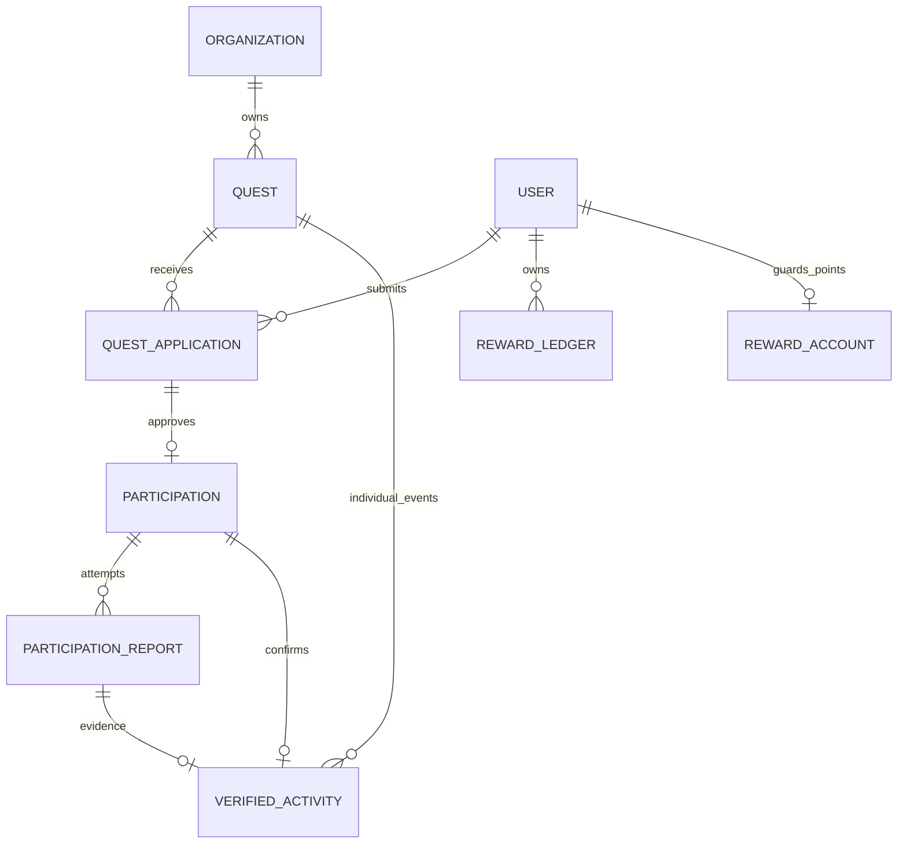
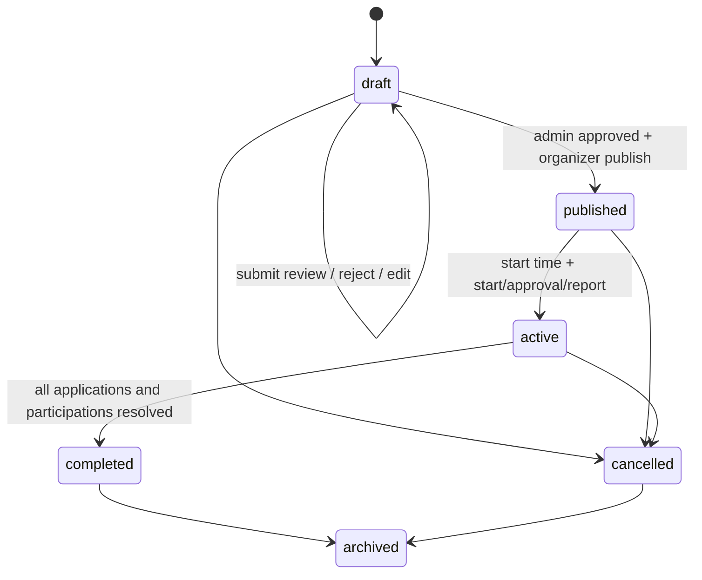

# DniproXP · BE-02 Quest Engine

## Статус і межі

Реалізація в коді поверх BE-01: QuestsModule, ParticipationsModule (із ReportsController і VerificationService), LedgerModule. Нових залежностей немає. Frontend і mocks не змінено й не підключено до HTTP. Foundation migration не редагувалася. Build/tests/lint/typecheck/dev/server/Docker/migrations/seed не запускалися; наведені гарантії описують реалізацію, а не результати виконаних перевірок.

Аудит охопив фактичні BE-01 modules/config/entities/auth/scope/audit/DTOs/seed та frontend Quest/Participation/QuestReport/Transaction, `applyParticipation`, repository transitions, impact verification, identity API, quest/organizer adapters, form schema, levels і API docs. Розбіжності історичних документів вирішено за фактичним кодом. Prefix `/v1`, nested errors/request IDs, JWT, users, organization memberships і AuditLog повторно використовуються.

## Файли

Створено `src/quests/{domain,http.decorators,locations,optional-jwt.guard,quest.entity,quest.mapper,quest.policy,quest.queries,quests.controller,quests.dto,quests.module,quests.service}.ts`, `src/participations/{participation.dto,participation.entity,participation.mapper,participation.policy,participation.queries,participations.controller,participations.module,participations.service,verification.service}.ts`, `src/ledger/{ledger.controller,ledger.dto,ledger.entity,ledger.module,ledger.service,levels}.ts`, `src/database/quest-seed.ts`, `src/database/migrations/1792195200000-quest-engine.ts` і цей документ.

Оновлено `src/app.module.ts`, `src/database/typeorm.config.ts`, `src/database/seed.ts`, `src/main.ts` (body limit), README та посилання з документа BE-01. Файли frontend, foundation migration, package.json і lockfile не змінювалися.

## Модель і відповідність frontend

- `Quest` → `quests.Quest` → CreateQuestDto/UpdateQuestDto/QuestDto/ManagedQuestDto → `/quests`, `/organizations/:id/quests` → public projection або active staff scope. Presentation `participants`, `availability`, `status`, `date`, `durationMinutes` обчислюються, не є writable columns.
- `Participation.applicationStatus` → окрема QuestApplication → ApplicationDto → applications endpoints → власник або staff свого quest. Заявка та участь більше не є одним overloaded записом.
- `Participation.status` → Participation → ParticipationDto → own participations/quest participants → власник або staff. Participation виникає після approval; pending заявка ще не є Participation.
- `QuestReport` / `reportHistory` → appendable ParticipationReport attempts → ReportDto → `/participations/:id/reports` → власний user; review лише уповноважений staff.
- `Transaction.xp/points` → дві RewardLedger entries з різними currency → LedgerEntryDto → `/users/me/rewards/transactions` → власний user. Клієнт не визначає reward amount при approval.
- `completed + confirmedAt + source event` → VerifiedActivity → VerificationDto/VerifiedActivityDto → report approval → approved org + active scoped reviewer. Це foundation для BE-03, не готовий Impact/collective API.
- Frontend `levelFor` → `ledger/levels.ts` → ProgressionDto → `/users/me/progression` → власний user.
- Командні налаштування Quest → allowTeamParticipation/teamParticipantLimit → Quest DTO. Team application endpoint НЕ реалізований: потрібні authoritative memberships BE-04.

Відмінності на HTTP-boundary:

- Backend UUID замість mock string IDs. identity/mocks не імпортуються у сервер.
- Використано реальні lifecycle `draft/published/active/completed/cancelled`, додано terminal `archived`. Немає дубльованого `pending_review` чи `in_progress`: review окремо від lifecycle.
- Frontend publish спочатку показує pending moderation; тут `submit-review → admin approve → publish`. Public draft ніколи не потрапляє у каталог.
- Canonical schedule — nullable startAt/endAt timestamptz, ISO з явним offset/Z; draft може не мати обох дат. Взаємна тривалість 30–720 хв. Дата/час форми Europe/Kyiv мають конвертуватися у точний instant із перевіркою DST на майбутньому adapter boundary. `date` response — alias startAt; локалізована `duration` готується з durationMinutes клієнтом.
- requirements/bring — arrays, form multiline strings розбиваються adapter-ом. Кожний перелік має сумарний ліміт 2000 символів із newline separators, як frontend textarea; допускається до 1000 коротких рядків. Canonical rewardPoints обов'язковий, 0–500; fallback `floor(xp/2)` для старих mocks НЕ використовується як неявне правило серверного verification.
- `status=available|completed` — сумісний presentation alias. Він не гарантує можливість join: перевіряти `availability` і lifecycle. Cancelled/archived відрізняються через lifecycle.
- Approved participation до startAt має planned; після startAt — active. На відміну від прискореного mock, схвалення до початку не означає вже виконану роботу. Є явні start endpoints; submit report також може перевести planned після початку в pending атомарно.
- actualHours → reportedMinutes, nullable unknown. Майбутній frontend adapter: `Math.round(actualHours*60)`, приймати лише 1–1440 хв або null. Не підставляти planned duration. Час із точністю менше хвилини потребує явного узгодження у майбутньому UI.
- Evidence приймається лише як порожній масив. Upload/media storage ще немає: довільні URL, localhost, file paths, data URIs і mock фото не приймаються як evidence. Немає фіктивного upload endpoint.
- Фото квестів — наявна frontend asset library із чотирьох `/images/*.jpg`. Backend не завантажує зовнішні URL. imageAlt зберігається окремо; за замовчуванням title.
- Координати задаються тільки через locationId із наявного curated catalog (`quest-4/7/20`). Source/label/lat/lng задає сервер. null/порожній locationId прибирає маркер; адресу без reviewed locationId не геокодують у випадкову точку.
- BE-01 `/auth/me`, `/users/me` зберегли стару lightweight statistics availability boundary. Новий authoritative read model XP/points/quests/minutes — `/users/me/progression`; це не означає, що Passport/Skill Tree/Teams уже перенесено.

## ER



`reward_accounts` — внутрішня guard projection для атомарного недопущення negative points, підтримується AFTER INSERT trigger; read API все одно рахує ledger. Вона не є довільно редагованим user balance чи другим джерелом нагород. Не змінювати її вручну.

FK до users/orgs/quests/reports — RESTRICT для історії. Composite FK звіряють application→participation (user/quest) і verified activity→participation/report. Унікальні user/quest application та participation; один submitted і один approved report на participation; одна verified activity на participation/report/user+quest/source event. Відхилені report attempts залишаються окремими історичними рядками.

## Lifecycle та state policies

Центральні правила: `quests/quest.policy.ts`, `participations/participation.policy.ts`; contextual permissions/time checks застосовують services.



Draft має moderation pending, але queue включає лише reviewSubmittedAt != null. Submit-review перевіряє повний контент/майбутню дату/approved org. Admin approve не публікує quest. Reject потребує reason; повторне подання на review дозволене. Edit draft/published до першої заявки скидає lifecycle у draft, moderation у pending, reviewSubmittedAt/reason у null. Після **будь-якої першої заявки**, включно з withdrawn/rejected, редагування умов заблоковано як у frontend; capacity не може бути зменшена нижче occupancy. Зміни не обходять повторну модерацію. publishedAt зберігає перший факт публікації; його наявності недостатньо для public visibility чернетки.

Завершення дозволене тільки з active, після врегулювання всіх pending applications і planned/active/pending participations. Воно нікого не верифікує та не видає нагород. Організатор може reasoned-cancel незавершену participation, щоб врегулювати no-show без скасування всієї події. Cancel quest переводить pending applications у withdrawn, усі незавершені participations у cancelled; completed contributions, reports, ledger та activities не видаляються. Submitted report скасованої участі лишається історією, але не входить у actionable pending queue. Archive лише completed/cancelled, не відновлює enrollment. Поле archivedFrom зберігає попередній terminal status; архівування завершеного quest не перетворює його presentation status на available.

Applications:

- pending → approved/rejected/withdrawn;
- approved → withdrawn лише для запланованої участі до startAt;
- withdrawn → pending при добровільному повторному поданні й наявності місць;
- rejected terminal: повторне подання заборонене як у frontend.

Participation: planned → active/pending/cancelled; active → pending/cancelled; pending → active (report rejection)/completed/cancelled. completed terminal. Cancelled participation повторно використовується тільки при легальному повторному approval добровільно withdrawn application. Організаторське скасування не створює такої можливості.

Report: submitted → approved або rejected. Жодного edit approved/rejected row. Після rejection participation стає active, наступний submit створює новий attempt. Повторний reject того самого attempt з тією самою reason повертає історичний attempt без зміни нового звіту. Зміна вже розглянутого рішення → 409.

## Permissions / RBAC

- Anonymous: лише public quest list/detail. Public projection не містить applications/reports, email, credentials чи moderationReason.
- VOLUNTEER: власна individual application, withdrawal, власна participation/start/report/history, власні balance/transactions/progression. userId завжди з JWT, не request body.
- ORGANIZER + active OWNER/MANAGER свого scope: create/edit/lifecycle/cancel individual participation. Role без membership недостатня.
- ORGANIZER + active OWNER/MANAGER/REVIEWER свого scope: application/report review та private queues. Review capability вимагає approved org. Publish/submit-review/start також потребують approved org.
- Active staff може читати приватні quests/apps/reports свого scope, включно з suspended org history; suspension блокує write verification/publication.
- ADMIN: moderation queue й approve/reject, явний private quest-detail read. Звичайні application/report/participant mutations чужої org **не** отримують bypass. Self-moderation org і self-review власної application/report заборонені.

Public detail підтримує optional bearer: без токена — лише published history зі схваленої org; із валідним токеном staff бачить свою чернетку, ADMIN — private quest metadata. Invalid bearer не ігнорується. Власні history responses містять quest snapshot навіть коли quest закритий або org більше не public, але не чужі заявки чи звіти. `/quests/:id/participants` є **staff-only roster**, а не публічним списком ідентичностей волонтерів.

## Endpoint catalog (prefix `/v1`)

Public / optional identity:

- GET `/quests`: filters category, district, difficulty, lifecycle, presentation status, from/to, organization, availability, search, minXp, page/pageSize/order/sort.
- GET `/quests/:id`: public або дозволена private projection.

Quest management (OWNER/MANAGER):

- POST `/quests`, PATCH `/quests/:id`.
- POST `/quests/:id/submit-review`, `/publish`, `/start`, `/cancel`, `/complete`, `/archive`.
- GET `/organizations/:id/quests`: active staff, всі власні стани; інша org → 403.

Admin moderation:

- GET `/admin/quests/pending`.
- POST `/admin/quests/:id/approve`, `/reject` (reason 5–1000).

Applications / participation:

- POST `/quests/:id/applications`: optional `{mode:"individual"}`; teamId/userId та зайві поля відхиляються. Repeat pending/approved не резервує друге місце.
- GET `/quests/:id/applications`: staff only.
- GET `/users/me/applications`.
- POST `/applications/:id/approve`, `/reject` (reason), `/withdraw` (власник).
- GET `/users/me/participations`.
- GET `/quests/:id/participants`: staff only.
- POST `/participations/:id/start`: власник, approved application, startAt настав, quest доступний.
- POST `/participations/:id/cancel`: власник planned до startAt або scoped OWNER/MANAGER із reason; completed не скасовується.

Reports / verification:

- POST `/participations/:id/reports`: description 30–2000, reportedMinutes nullable 1–1440, evidenceReferences тільки [].
- GET `/participations/:id/reports`: pagination усіх власних/дозволених attempts.
- GET `/organizations/:id/reports/pending`: staff scoped actionable queue.
- POST `/reports/:id/approve`: авторитетні rewards із незмінної approved quest configuration; 200 з report, activity та двома ledger transactions.
- POST `/reports/:id/reject`: reason 5–1000; не видає нагороди.

Read models:

- GET `/users/me/rewards/balance`.
- GET `/users/me/rewards/transactions`: optional currency, pagination/order.
- GET `/users/me/progression`.

POST create quest/application/report: 201. Повторна application може також повернути 201 з тим самим id. Lifecycle/review/withdraw/start/cancel: 200. Помилки використовують BE-01 nested envelope і requestId: 401/403/404/409/422; unique conflict → 409. Idempotency mismatch → IDEMPOTENCY_CONFLICT; full quest → CAPACITY_EXCEEDED; unresolved completion → UNRESOLVED_PARTICIPATIONS. Немає public write API ledger або spend/redeem endpoint.

Pagination: page >=1, pageSize 1–100 (default 20), order ASC/DESC, UUID tie-breaker. Catalog sort=date/createdAt/xp/title; from inclusive, to exclusive, ISO instants (date-only означає UTC, не Kyiv calendar-day). Для Kyiv-date UI майбутній adapter повинен передати правильні offset boundaries. Search — bounded literal substring title/description; `%/_` екрануються. Catalog excludes draft завжди, навіть якщо явно передати lifecycle=draft. Опубліковані completed/cancelled/archived доступні як історія за public permissions; availability=false не означає draft visibility.

## Concurrency та atomic verification

Усі capacity mutations використовують Transactions.run. Порядок locks: organization → Quest → application → participation → report → user/ledger. Organization lock серіалізує moderation/staff changes із quest actions; це консервативне блокування також серіалізує різні quests однієї org. Future batch operations мають дотримуватися того самого порядку й стабільного порядку user UUID. Не тримати user lock, а потім намагатися взяти інший existing org lock.

Pending application резервує 1 місце; approved participation planned/active/pending/completed також займає 1. Withdrawn/rejected і cancelled participation не займають місць. Завершена участь не вивільняє слот для другої групи у тому самому quest. Немає імпортованого frontend base participants counter. Capacity рахується під Quest lock; unique(user,quest) не дозволяє паралельні дублікати. Pending → approved не додає друге місце. Після endAt нові заявки/approval/start participation недоступні; rejection pending application і review звітів після часу події дозволені, поки quest active/published. Подання звіту не залежить від planned hours і не є auto completion.

VerificationService:

1. Resolves report→participation→quest; locks org/quest, перевіряє активний scoped reviewer/approved org, забороняє self-review.
2. Locks application, participation і конкретний report attempt; перевіряє належність, approved application та потрібні стани.
3. Ставить report approved + reviewer/time; participation completed + confirmedAt.
4. Створює XP та REWARD_POINTS credits через LedgerService тим самим EntityManager.
5. Створює одну append-only VerifiedActivity із snapshot category/district/org і stable sourceEventId.
6. Пише AuditLog; commit відбувається лише після всіх кроків.

Помилка на будь-якому кроці, включно з audit або deferred DB checks, відкочує все. Немає нетранзакційного increment user.xp. Повторний approval повертає той самий report/activity/ledger IDs без нового award/audit. Якщо permission/state вже змінився, може повернути контрольований conflict/forbidden; нової нагороди немає.

Idempotency: `completion:<userUUID>:<questUUID>:<currency>`, activity sourceEventId без currency; DB uniques за key і source dimensions. Ledger ключ із іншим payload дає conflict. Rejected attempt не можна пізніше approve; новий submitted attempt має інший report ID, але completion лишається один на participation/user+quest.

## Database ledger guarantees

- UPDATE/DELETE/TRUNCATE ledger та verified activity заблоковані triggers. DELETE report/application/participation history теж заборонений. Відредагувати reviewed report не дозволяє DB trigger.
- Deferred constraint triggers при commit звіряють обидві completion currency entries, approved report/application, completed participation та verified activity з approved quest amounts і measured minutes/reviewer/time. Часткова completion без повного набору не комітиться.
- AFTER INSERT ledger trigger атомарно змінює guard balance у reward_accounts; negative result не проходить conditional UPDATE + CHECK. Це працює і для concurrent inserts; trigger виконується лише для фактично вставленого рядка, не ON CONFLICT no-op.
- LedgerService додатково бере user lock і перевіряє доступний ledger-derived баланс перед debit. Немає HTTP debit у BE-02. Internal spendPoints/compensate — реальні transaction-only протоколи для майбутнього BE-05, де caller повинен перевірити domain authorization/stock та записати domain audit у тій самій транзакції.
- Коригування — новий COMPENSATION row з originalId/reason; старі entries не змінюються. XP не списується (накопичуваний ресурс), points можуть мати контрольовані debits. Безпечний rollback/read API не реконструює або видаляє історію.
- Runtime DB role не має отримувати DELETE/TRUNCATE/DDL права на ці таблиці; reward_accounts — internal trigger-maintained projection, не редагувати напряму. DB owner може змінити triggers, тому schema ownership не є runtime privilege. Схема grants не створюється автоматично.

Read progression виконує один агрегатний SQL snapshot: SUM XP/RP ledger, count verified activities, SUM known verifiedMinutes і unknownMinutesCount. Непідтверджені reports не враховуються. Якщо activities немає — minutes=0; якщо всі виміри unknown — null; при сумі відомих і невідомих повертає відому суму та unknown count. Немає підстановки planned hours. Bigint totals перевіряються на JS safe integer, overflow дає контрольовану недоступність, не втрату точності.

Рівні дослівно відповідають frontend thresholds 0/250/600/1000/1600/2400/3400/4800; ті самі назви. Progress не округлюється додатково; xpToNextLevel — різниця порогів, на max level null/progress 100. RP balance не впливає на level.

## Міграція та seed

Нова migration: `1792195200000-quest-engine`, class QuestEngine1792195200000, після виконаної `1792108800000-foundation`. Включена у спільний CLI/boot DataSource config; migrationsRun/synchronize/installExtensions залишаються false. Foundation файл не змінено. Таблиці: quests, quest_applications, participations, participation_reports, reward_ledger, internal reward_accounts, verified_activities. down явно прибирає лише BE-02 tables/functions; це руйнівна ручна операція, не production rollback без backup.

Міграції керуються вручну: composite FKs, functional/partial indexes і trigger functions не можна втратити через непроглянутий auto-generated diff. Boot не робить schema mutation. Валідаційний body limit збільшено з 16 до 128 KiB: допустимий Quest payload із Unicode та arrays може перевищувати старий ліміт; усі field/array bounds збережені.

Чинний seed gate (development/test + ALLOW_DEMO_SEED=true + ENV credentials) збережено. `database/quest-seed.ts` викликається всередині наявної seed transaction/advisory lock після створення/перевірки BE-01 identities. Ідемпотентні unique be02 seed markers; existing quests і всі їхні операційні зміни не перезаписуються. Не скидає passwords, balances, reports або moderation. Колізія scope чи відсутність необхідного approved org/capability для нових fixtures відхиляє транзакцію, а не обходить права.

Створює 12 явно demo quests усіх шести frontend categories у Дніпрі: 6 published, draft, submitted-review draft, 2 completed, cancelled і active із reports. Адреси — демонстраційні орієнтири, не реальні оголошення; reviewed координати лише для 3 відомих public areas. Дати встановлюються при першому створенні й не зсуваються при повторному запуску; fixture може природно застаріти, seed його не «оживляє».

Є pending/rejected/withdrawn applications, planned approved participation, submitted/rejected reports та cancelled history. Для completed fixtures створюються три verified activities (одна має unknown time); усі шість ledger entries походять зі спільного VerificationService.approveWithin — без counters або прямого присвоєння XP. Repeat seed існуючих quests не створює нових awards. Це явні dev fixtures, а не підтвердження реального волонтерства.

## Команди для самостійного запуску

Не потрібно встановлювати нові залежності. Після локального review змін і чинного BE-01 ENV:

```sh
pnpm --filter api typecheck
pnpm --filter api lint
pnpm --filter api test
pnpm --filter api build
pnpm --filter api db:migrate
# Опційно, тільки development/test + чинний ALLOW_DEMO_SEED та SEED_* ENV:
pnpm --filter api db:seed
# Якщо API вже працює, перезапустити його окремо після migration.
pnpm --filter api start:prod
```

Не запускати повторну foundation migration вручну: CLI tracking застосує лише наступну pending migration. Не використовувати db:revert на БД з цінною історією. Для e2e потрібна окрема disposable PostgreSQL database з обома міграціями; наявний starter test не покриває новий домен.

Самостійно перевірити: unauthorized/cross-org/self review; повний publish/review workflow; concurrent last-seat apply; duplicate approval; reject/resubmit; withdraw/reapply; pending reservation release; concurrent report approvals; retry після timeout; rollback при помилці ledger/activity/audit; negative debit й append-only DB guards; draft privacy; suspended organization; повторний seed і seed collision. Тести цих нових сценаріїв у цьому етапі не запускалися.

## BE-03/04/05 та ризики

BE-03 читає committed immutable VerifiedActivity за stable UUID/sourceEventId. Це **індивідуальний внесок**, не collective Impact. Collective metrics потребують окремого quest-scoped record та deduplication; не множити на кількість учасників. Немає реалізованого outbox/delivery worker, Impact metrics API чи Mission/Challenge aggregation; для transport delivery додати outbox/cursor semantics окремо.

BE-04 має додати Teams/memberships/batch authorization. Поля allowTeamParticipation/teamParticipantLimit уже валідовані та збережені, але individual application завжди займає рівно 1 місце, а довільний teamId відхиляється. Future team application повинна резервувати індивідуальні місця в тій самій capacity transaction й породжувати один verified contribution на конкретного волонтера.

BE-05 використовує internal LedgerService spending protocol і DB balance guard, але має реалізувати rewards stock, authorization, redemption entity/unique request keys, audit та workflow компенсацій. Магазин/платежі/довільний ledger write API тут відсутні.

Обмеження перед deployment: код не запускався; потрібні PostgreSQL integration/concurrency tests і перевірка compiled OpenAPI/DTO metadata. Консервативний org-level lock обмежує паралелізм великих org; DTO projections зараз використовують bounded N+1 reads (pageSize ≤100), їх варто оптимізувати після вимірювань. Catalog counters — інформаційний read model, остаточна capacity перевіряється під lock. Offset pagination не дає snapshot між сторінками. Публікація/verification без scoped membership неможливі навіть для ADMIN. Відсутні trusted media uploads, notifications, time-zone form adapter, Teams API, collective Impact та production HTTP frontend adapter.
