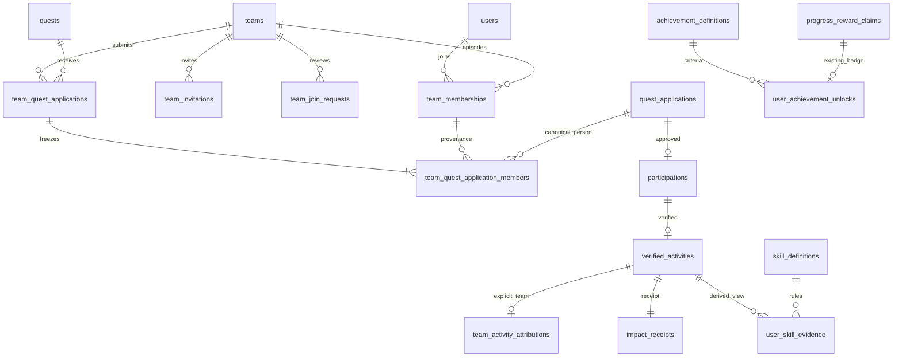

# BE-04 — Volunteer Identity, Teams, Skills, Achievements & Passport

## Handoff і межі виконання

Реалізація в `apps/api`, поверх BE-01/02/03, без frontend/mocks, нових залежностей або зміни виконаних міграцій. Build, tests, lint, typecheck, Docker, сервер, migrations і seed **не запускалися**. Нижче опис реалізації, а не результати перевірок. Потрібне локальне review та PostgreSQL integration/concurrency validation перед deployment.

Міграція: `VolunteerIdentity1792368000000` (`1792368000000-volunteer-identity.ts`), після `1792281600000`. `synchronize`/автоматичні міграції залишаються вимкненими. Up/down вимагають active migration transaction. Down блокує джерела, перевіряє відсутність нової історії і відмовляється видаляти teams, attributions або unlocks. Backfill на БД із verified contributions уже створює unlock history, отже destructive revert там заборонений. Використовувати forward migrations для корекцій.

## Нові й змінені файли

Нові:

- `src/identity/catalog.v1.ts`, `src/identity/privacy.ts`;
- `src/teams/team.entity.ts`, `team.dto.ts`, `team-access.service.ts`, `teams.service.ts`, `team.queries.ts`, `teams.controller.ts`, `teams.module.ts`;
- `src/team-applications/team-application.entity.ts`, `team-applications.service.ts`, `team-applications.controller.ts`, `team-applications.module.ts`;
- `src/skills/skill.entity.ts`, `skills.dto.ts`, `skill-progress.engine.ts`, `skills.controller.ts`, `skills.module.ts`;
- `src/achievements/achievement.entity.ts`, `achievements.dto.ts`, `achievement-evaluator.ts`, `achievements.service.ts`, `achievements.controller.ts`, `achievements.module.ts`;
- `src/passport/passport.dto.ts`, `passport.service.ts`, `passport.controller.ts`, `passport.module.ts`;
- `src/database/migrations/1792368000000-volunteer-identity.ts`, `src/database/identity-seed.ts`;
- цей документ.

Інтеграційні зміни:

- `src/app.module.ts`, `src/main.ts`: п’ять модулів та опис Swagger;
- `src/database/typeorm.config.ts`, `src/database/seed.ts`: явні entities/migration та gated seed;
- `src/participations/participation.entity.ts`, `participation.dto.ts`, `participation.mapper.ts`, `participation.queries.ts`: nullable teamApplicationId у canonical application/participation та response;
- `src/participations/participations.service.ts`, `participations.module.ts`: композиційні transaction methods, scoped membership validation та stamping під час approval; експорт існуючої служби для групового workflow;
- `src/users/users.dto.ts`, `users.service.ts`: additive passportUrl у видимому BE-01 public profile;
- `README.md`, посилання в BE-02/BE-03 документації.

Не змінені `VerificationService`, reward ledger, balances, Levels, BE-03 Impact/progress алгоритми та три виконані міграції. Рефакторинг participation зберігає індивідуальні маршрути і state machine; один додатковий guard не повторює cancelled→cancelled під час відкликання повторно поданої pending-заявки зі старою cancelled participation.

## Architecture та relationships

`TeamsModule` — спільнота, membership/requests/invitations, centralized TeamAccess, SQL statistics. `TeamApplicationsModule` — orchestration над чинним `ParticipationsService`, а не друга машина персональних заявок. `SkillsModule` — read-only evidence/progression. `AchievementsModule` — definitions, append-only unlocks, evaluator та public/private projections. `VolunteerPassportModule` — композиція Users/Preferences, Ledger, VerifiedActivity, Skills, Achievements, memberships та ImpactReceipt.



`team_progress_locks` — внутрішній row lock для серіалізації achievement evaluation команди; це не сховище counters. Passport не має власної таблиці, balances чи privacy store. Ідентифікатор `DNX-<user UUID>` стабільний і обчислюється з identity, не є сертифікатом юридичного/професійного статусу.

## Frontend → Backend → Entity → DTO → Endpoint → permissions

Досліджено `entities/team/{types,calculator,form-schema}`, `entities/skill/{types,catalog,calculator}`, `entities/passport/types`, `mocks/identity-{api,commands,selectors,integration,data}`, `mocks/repository`, definitions `mocks/data`, сторінки/компоненти teams/skills/passport, frontend contracts та `docs/epic-03-identity-teams.md`.

- Team → TeamsModule → Team → TeamDto → `/teams`, `/teams/:id` → PUBLIC або активний membership; pending unexpired invitation дозволяє лише private detail preview.
- TeamRole **OWNER/MANAGER/MEMBER** → TeamAccess capabilities → TeamMembership → MemberDto → `/teams/:id/members` → внутрішній roster учасникам; публічний roster лише за профільними дозволами. OWNER відповідає captain, MANAGER — officer; нові несумісні enum CAPTAIN/OFFICER не введено.
- TeamFormValues → validated TeamFormDto/UpdateTeamDto → Team → `POST/PATCH /teams` → VOLUNTEER створює, OWNER/MANAGER редагує. `ownerId` aliases captainUserId; `maxMembers` maps memberLimit. Public DTO приховує captain identity поза scoped roster, якщо профіль не дозволяє її опублікувати.
- JOIN_TEAM → OPEN join policy → membership episode + approved request → JoinRequestDto → `POST /teams/:id/join-requests` → активний VOLUNTEER. APPROVAL — додаткова явна політика для запитаного backend workflow; PRIVATE завжди INVITE_ONLY, як frontend.
- Invitations → TeamInvitation → InvitationDto → own invitation list/respond routes → адресат або OWNER/MANAGER для revoke. Термін 7 днів, як frontend.
- TeamQuestParticipation → TeamQuestApplication + immutable members → TeamApplicationDto → `/quests/:id/team-applications`, `/teams/:id/quest-applications` → OWNER/MANAGER створює; scoped org reviewer приймає рішення.
- Participation.teamParticipationId frontend → nullable `teamApplicationId` canonical app/participation → additive field існуючих DTO BE-02 → старі individual endpoints. HTTP adapter має зіставити назви; frontend не переключено на HTTP у цьому епіку.
- TeamStatistics/teamRanking/teamAchievements → explicit attributions + VerifiedActivity → TeamStatisticsDto/TeamRankingDto/TeamAchievementDto → statistics/contributions/leaderboards/achievements → private team membership або публічна знеособлена статистика; named rows мають окремий privacy gate.
- SkillDefinition/SkillProgress → frozen catalog + user_skill_evidence SQL view → SkillDefinition/UserSkillEvidence → skill DTOs → `/skills`, `/users/me/skills`, `/users/:id/skills` → каталог публічний; own evidence приватна; public projection через preferences.
- `achievements` frontend targets 1/5/20 → AchievementDefinition + AchievementUnlock → achievement DTOs → `/achievements`, own/public achievements → системний unlock, жодного client grant.
- BE-03 exploration badges → існуючий ProgressRewardClaim → один AchievementUnlock на claim → achievement/passport DTOs → own/public achievements → original ledger винагороду не повторюємо.
- VolunteerPassport → live read projection → User/Preferences + джерела → PassportSummaryDto, PassportStatsDto, PassportActivityDto, PrivatePassportDto, PublicPassportDto → own/public passport routes → BE-01 privacy flags; public URL завжди public view навіть для власника.

## Team lifecycle, permissions та membership

Команда ACTIVE → ARCHIVED. Archive потребує відсутності pending applications та planned/active/pending participations, явно атрибутованих цій команді. Verified/completed history лишається. Pending invitations відкликаються, requests скасовуються. Повтор archive повертає поточний стан. Archived не редагується, не приймає нових membership або заявок; наявні episodes збережені, як у frontend.

Capabilities централізовані в `TEAM_CAPABILITIES`:

- OWNER: edit, invite/approve, team quest apply/withdraw, зміна MANAGER/MEMBER, transfer та archive;
- MANAGER: edit, invite/approve, team quest apply/withdraw, remove тільки MEMBER;
- MEMBER: внутрішній roster/read, власний leave, персональний report/cancel у межах BE-02;
- OWNER не може leave/remove чи стати MEMBER через role endpoint: потрібна transfer або archive;
- team role не надає прав ORGANIZER/ADMIN або організаційного scope. ADMIN не обходить membership/organization checks.

Дозволено кілька активних команд на користувача: frontend не має single-team restriction. Unique active(team,user), partial unique active OWNER(team), deferred captain consistency та member capacity guards у БД. Team edits також не можуть зменшити limit нижче active count. Transfer: під team lock старий OWNER стає MANAGER, target активний учасник стає OWNER, captainUserId змінюється в тій самій transaction; проміжний стан без captain не комітиться.

Membership ACTIVE → LEFT/REMOVED, joinedAt/leftAt та invite/approval provenance зберігаються. **Повторний вступ створює новий UUID episode**, не оживляє старий. Це навмисне посилення backend history порівняно з mock, який перевикористовує membership object. Group snapshot продовжує посилатися на початковий episode. Terminated membership не редагується; physical deletion/truncate заборонені.

OPEN request приймає сервер за політикою команди; це не право клієнта схвалити власну APPROVAL request. Для APPROVAL requester не може review свою заявку навіть якщо пізніше отримав роль. Rejection потребує причини. Capacity перевіряється при реальному вступі під lock, pending request/invitation не резервує team member slot.

Invitations: PENDING → ACCEPTED/DECLINED/REVOKED/EXPIRED. Unique pending(team,target), team lock, перевірка адресата, fresh active VOLUNTEER та limit на accept. Expiry відображається і в read projection, а mutations фіксують terminal transition. Expired accept/decline комітить expiry й повертає 409, не створюючи membership. Retry ACCEPTED повертає попередній результат і не відновлює завершене членство. Reinvite після expiry створює новий запис. Pending duplicate повертає попереднє invitation.

## Team quest workflow і capacity

Порядок: organization → quest → team → canonical application/participation. Під одним quest lock перевіряються approval/lifecycle/endAt, allowTeamParticipation, teamParticipantLimit, активний OWNER/MANAGER, оригінальні active membership episodes кожної вибраної людини й активні VOLUNTEER accounts. User IDs із payload — лише кандидати, їх не приймаємо без перевірки.

Склад не порожній, без дублів, максимум teamParticipantLimit та 50. Перевіряється free seats ≥ selected people. Для кожної людини створюється/повторно подається canonical BE-02 quest_application з унікальністю `(user,quest)`; pending резервує **одне персональне місце**. Parent group не додає другого резервування. Тому індивідуальні та командні заявки ділять одну формулу `occupied`, один quest lock та один capacity guard. Додані DB seat triggers на applications/participations/quest capacity.

Rejected application повторно не подається, active/approved/verified не дублюється. Withdrawn може бути подана повторно: canonical row перевикористовується, old group/member snapshot лишається. teamApplicationId live-заявки/участі заморожений; переприв’язка можлива лише з withdrawn application або cancelled participation, коли новий workflow схвалюється. Completed participation ніколи не переприв’язується.

Unique(team,operationId) із порівнянням submitter/quest/повного набору людей робить apply retry ідемпотентним; інший payload →409. Composite FK group↔canonical person↔membership та deferred roster count не дають комітити неповний чи підмінений склад. Immutable member rows не дозволяють непомітно додавати/видаляти людей після submit або approval.

Scoped organizer approve викликає **ті самі** `ParticipationsService.reviewWithin` для кожного canonical application в одній transaction. Створюється одна Participation на людину; повтор не дублює participation. Особистий review у BE-02 також підтриманий, але approval перевіряє активність команди й початкового membership episode. Actor не може review себе. Team captain не може approval через організаційний endpoint без реального scoped org permission.

Group reject/withdraw атомарні. Якщо частина складу вже має несумісний terminal/started state, команда має врегулювати ці персональні записи звичайними BE-02 командами, а не стирати їх груповим рішенням. Captain/MANAGER може withdraw pending або ще planned до початку; audit містить справжнього керівника, а не підставлених actor IDs учасників.

Computed group status із SQL view `team_application_progress`, як frontend reconciliation:

- є verified completions і всі live записи completed → COMPLETED;
- є хоча б один completion, але лишилися live незавершені → PARTIAL;
- усі актуальні особисті заявки rejected → REJECTED;
- немає live записів → CANCELLED;
- є active/pending report participation → IN_PROGRESS;
- усі live approved → APPROVED;
- решта → PENDING.

Parent review metadata позначає групове рішення; якщо людей схвалювали окремо, computed status може бути APPROVED при null parent reviewedAt. Персональні reviewers/times зберігаються у BE-02. API не вигадує спільного reviewer заднім числом.

### Вихід/видалення з команди

До approval: source membership episode уже не ACTIVE, тому approval цієї людини відхиляється. Pending персональний reserve залишається до явного withdraw/reject/cancel квесту; вихід не робить прихованих cross-quest mutations. Для нового episode потрібне відкликання та нова командна заявка.

Після approval: заморожений склад та team attribution залишаються. Користувач може виконати своє зобов’язання і подати власний report навіть після leave/remove. Звіт, approval, XP, points та receipt належать особі; team history не перераховується за поточним roster. Після verification будь-який leave/remove/transfer не змінює source та особисту історію. Повторний вступ не подвоює attribution.

## Verification та provenance

`verified_team_attribution` AFTER INSERT VerifiedActivity читає stamped Participation і immutable TeamQuestApplicationMember, створює один `TeamActivityAttribution` та audit. Unique verifiedActivityId/participationId, composite FKs та source validation trigger звіряють person/quest/participation/membership/group. Старі individual completions з null teamApplicationId не приписуються команді, створеній пізніше.

`zz_identity_verified` AFTER INSERT викликає SQL evaluator у тій самій verification transaction, після team attribution та BE-03 Impact triggers. PostgreSQL AFTER triggers упорядковано за іменем. Нові team awards/unlocks, Audit, personal ledger, verified source, ImpactEvent та receipt відкотяться разом при будь-якій помилці, включно з deferred BE-02/03 guards. Fire-and-forget, mutable counters чи queue немає.

Skills — SQL projection, доступна одразу після committed verification; повтор read/recompute нічого не накопичує вдруге. Achievement evaluator серіалізує subject user (у verification/claim user lock уже є), а team — через окремий team_progress_locks row. Він не бере team management row lock після recipient lock. Team writes використовують FOR NO KEY UPDATE, сумісний із FK KEY SHARE, щоб не створювати цикл membership/verification locks.

## Team statistics та collective Impact

Джерело: `TeamActivityAttribution → VerifiedActivity`, не всі поточні активності membership users.

- hours = SUM відомих verifiedMinutes/60; unknownMinutesCount пояснює частковість, hours=null коли відомих вимірів немає;
- verifiedQuests = DISTINCT questId; verifiedParticipations = COUNT attributed sources;
- completedQuests = кількість computed COMPLETED group workflows із verified quest у вибраному періоді, як frontend;
- XP = SUM base xpAwarded цих verified activities; mission/challenge bonus та чужий/індивідуальний XP не стають командними;
- activeMembers = current active episode count; volunteers = distinct реально verified contributors, включно з тими, хто вийшов;
- categories/districts — immutable snapshots verified activity, trends — Kyiv calendar days;
- period `all` або поточний `month` Europe/Kyiv. Named leaderboards: відомі хвилини DESC, verified participation count DESC, UUID ASC. Public team ranking має ту саму формулу.

`totalVerifiedHours`, `totalCompletedQuests`, `totalXP` у team get/list — SQL-derived all-time summary, не stored counters. Ranking summaries мають свій явно вибраний period.

Collective правило з frontend: кожна команда з хоча б одним attributed verified source квесту бачить current collective measurement цього квесту **один раз на quest/metric**, незалежно від розміру команди. Та сама shared метрика може бути контекстом кількох команд, але не є їхньою адитивною власністю. Response позначає `QUEST_SHARED_NOT_ADDITIVE`; їх не можна сумувати між командами. Глобальний city total залишається BE-03 source aggregation, де quest/metric враховано один раз. Відсутні виміри null, а не XP-конверсія; нульове підтверджене значення зберігається. Current version/supersedes provenance залишається в BE-03; власники team roles не отримують права підтверджувати physical metrics організації.

## Skills та mastery

16 versioned definitions із восьми frontend branches: eco, social, events, education, communication, leadership, logistics, digital; дві навички в кожній. UUID ↔ frontend slug `eco-1`, тощо. Catalog V1 завантажується міграцією для всіх environments, не лише demo seed, та захищений append-only guards. Для зміни формули потрібна нова версія каталогу й forward migration.

SQL view `user_skill_evidence` має одну детерміновану identity на (skill,verified source). Eligibility: snapshot category у eligibleQuestCategories; для leadership потрібен справжній team attribution. Формула для кожного eligible source: baseXp (20 basic/15 specialization) + actualHours × 10. Це **mastery XP**, не валюта, не reward ledger і не можливість списання.

Невідомі actual minutes не підміняються planned duration чи 0; такий source не створює skill evidence/base XP. Сам verified quest/achievement/Impact history залишається. Пороги `[0,40,120,260,480]`, рівні 0..4; specialization потребує basic level≥1. Earned mastery зберігається навіть поки prerequisite locked; level/percentage при lock —0. Інакше level=max досягнутого порога, percentage=(earned-start)/(next-start)×100 у межах 0..100; level4 → nextLevelXp=null, percentage=100. Це frontend calculator semantics.

Докази містять source UUID, quest, підтверджений час, earned mastery та confirmedAt. `updatedAt` — останній власний qualifying source, не штучний час GET. Рівень0 без доказів має NO_VERIFIED_EVIDENCE; сам факт видимості гілки не означає verified competence. Frontend не має declared skills command: mutation для заявлення/довільного підвищення не додано.

Запити пакетні: totals + preview останніх 5 evidence на skill, count/hasMoreEvidence; повна історія окремим private paginated route. Repeated read/recompute не змінює mastery/валюти.

## Achievements та badges

Персональні frontend definitions: перший verified quest, 5 verified quests, 20 verified quests. Додані tiers як metadata, без вигаданих bonus amounts. Team definitions: перша attributed participation, 3 distinct eco quests, 100 підтверджених годин, 2 distinct city quests. Unique subject/achievement та append-only unlocks/evidence/audit. Невідомі години не заважають quest-count badge, але не допомагають hours threshold.

`dniproxp_evaluate_identity` — єдиний PostgreSQL evaluator; `AchievementEvaluator.recompute` — internal transaction API для replay/backfill, без HTTP grant route. Нові verification та BE-03 ProgressRewardClaim викликають його DB triggers. Міграція backfill існуючих verified sources і claims ідемпотентна; created badges не породжують currency entries.

BE-03 badges копіюються в один unlock на original progressClaimId зі snapshot achievement/evidence/unlockedAt. Оригінальний reward claim та його ledger залишаються єдиною виплатою. Базові/командні achievements не мають бонусів у frontend, тому XP/Reward Points за них не додаються.

«Команда місяця» — **поточна періодична проєкція**, не довічний unlock: перше місце серед PUBLIC teams поточного Kyiv month, ≥10 відомих годин і ≥2 distinct quests. Не створює нагород або історичної перемоги до закриття місяця. Team achievement API явно має periodic=true та unlockedAt=null для цієї відзнаки.

## Passport, Users та privacy

GET own Passport має повні права доступу до всіх секцій, але bounded previews: до 6 badges, skills, teams, organizations, activities, receipts; skills мають свої preview evidence. Є total counts, dedicated paginated own routes. Жодного email, password hash, token, report body, media/private report references у passport немає.

XP/level → LedgerService/чинні LEVELS; RP balance тільки own; hours/quest count → verified sources; volunteerSince → перше verification (null, якщо немає), joinDate → User.createdAt; skills → evidence view; badges → unlocks; teams → active memberships; team contributions → immutable attribution; receipts → BE-03. Це read model, не окремий profile store.

Використано чинні `UserPreferences`: publicProfile, showDisplayName, showVerifiedHours, showAchievements, showSkillProgress, showTeams, showActivityHistory, showOrganizations. Окремих несумісних passport preferences не створено. Зміна `PATCH /users/me/preferences` одразу змінює всі public projections. BE-01 public profile зберіг форму й отримав additive passportUrl.

Public passport/skills/achievements URL **завжди public**, навіть із JWT власника. Own маршрут використовує лише principal ID; query userId не обирає чужі дані. Missing/inactive/private passport → `{restricted:true}`. Не можна отримати повний private DTO через public request.

- showDisplayName керує name/avatar/bio; основні XP/level/completed counts — frontend publicProfile semantics;
- без showVerifiedHours немає фактичних годин, unknown count, точного mastery XP/percentage, з яких можна відновити тривалість;
- без showActivityHistory немає activity list, volunteerSince і точних unlock dates; skill evidence UUID/earnings завжди приватні, навіть при public skills;
- showAchievements дозволяє badge snapshot без source IDs; showOrganizations — bounded approved organization experience, без годин за закритого showVerifiedHours;
- showTeams показує лише PUBLIC team memberships; приватна команда не з’являється у чужому Passport;
- own receipts route делегує існуючому ImpactService з principal ID; public credential verification залишається BE-03 `/impact/receipts/public/:reference` з власними privacy checks. Private receipt UUID/source fields не потрапляють у public Passport activity.

Named team contributions/leaderboards доступні лише за ACTIVE publicProfile + showDisplayName + showTeams + showActivityHistory + showVerifiedHours. Власні source rows доступні користувачу й після leave. Інші team roles не відкривають приватних report/hours. Anonymous totals включають приватні внески без IDs. Внутрішній roster активної команди доступний її учасникам для організації взаємодії; публічний roster фільтрує приватні профілі. Pending invite дає лише private team preview, не roster/statistics/requests.

## Повний каталог нових endpoints

Prefix `/v1`; standardized BE-01 nested errors/requestId, Swagger DTOs та validation. UUID paths — v4. Page defaults page=1/pageSize=20/max100, stable tie IDs. `order` ASC/DESC у catalog/history; fixed member/leaderboard/ranking queries не приймають direction чи зайві фільтри, бо мають domain sort. `search/category` застосовуються до team catalog, `category` також до team ranking; `period=all|month` — statistics/rankings/contributions. Інші history lists використовують pagination.

Teams/public або optional JWT:

- `GET /teams`
- `GET /teams/leaderboard`
- `GET /teams/:id`
- `GET /teams/:id/members`
- `GET /teams/:id/statistics`
- `GET /teams/:id/contributions`
- `GET /teams/:id/leaderboard`
- `GET /teams/:id/achievements`

Authenticated VOLUNTEER commands, додаткові team permissions перевіряє сервіс:

- `POST /teams`
- `PATCH /teams/:id`
- `POST /teams/:id/join-requests`
- `GET /teams/:id/join-requests` (OWNER/MANAGER)
- `POST /teams/:id/join-requests/:requestId/approve`
- `POST /teams/:id/join-requests/:requestId/reject` (reason)
- `POST /teams/:id/join-requests/:requestId/cancel` (requester)
- `POST /teams/:id/invitations` ({userId})
- `POST /team-invitations/:id/accept`, `/decline` (recipient)
- `POST /team-invitations/:id/revoke` (OWNER/MANAGER)
- `POST /teams/:id/leave`
- `POST /teams/:id/members/:userId/remove`
- `POST /teams/:id/member-roles` ({userId,role: MANAGER|MEMBER}, OWNER)
- `POST /teams/:id/transfer-captain` ({userId}, OWNER)
- `POST /teams/:id/archive` (OWNER)

Own JWT:

- `GET /users/me/teams`
- `GET /users/me/team-invitations`
- `GET /users/me/team-join-requests`
- `GET /users/me/team-contributions`

Team quest workflow:

- `POST /quests/:id/team-applications` ({teamId,participantIds,operationId}; VOLUNTEER + OWNER/MANAGER)
- `GET /quests/:id/team-applications` (ORGANIZER + scoped OWNER/MANAGER/REVIEWER)
- `GET /teams/:id/quest-applications` (active member)
- `POST /team-applications/:id/approve`, `/reject` (ORGANIZER + scoped reviewer)
- `POST /team-applications/:id/withdraw` (VOLUNTEER + OWNER/MANAGER)

Skills:

- `GET /skills`, `GET /skills/:id` — definitions;
- `GET /users/me/skills`, `GET /users/me/skills/:id/evidence` — own JWT;
- `GET /users/:id/skills` — privacy-aware public.

Achievements:

- `GET /achievements` — definitions;
- `GET /users/me/achievements` — own JWT;
- `GET /users/:id/achievements` — privacy-aware public.

Passport:

- `GET /users/me/passport`
- `GET /users/:id/passport`
- `GET /users/me/passport/activities`
- `GET /users/me/passport/receipts`

Контрольні HTTP statuses: create/invite/team apply 201; commands 200; malformed UUID 400; invalid body/query 422; no session 401; wrong role/scope 403; invisible resource 404; duplicate people/capacity/lifecycle/idempotency/expired 409. Leave/remove повертає acknowledgement, тому private-team leave не закінчується спробою прочитати вже недоступну команду.

## Migration та demo seed

Catalog V1, constraints, indexes, views, triggers, user achievement backfill створює нова міграція. Existing individual activities не отримують team attribution. Нових bonus проводок або змін reward_accounts міграція не створює. Старі source tables отримують лише nullable teamApplicationId та нові consistency/capacity triggers; виконані SQL migrations не редаговано.

Seed викликається **після** чинного BE-01/02/03 seed у його gated development/test transaction/advisory lock (ALLOW_DEMO_SEED + explicit SEED_* credentials). Збережено існуючі п’ять контрольованих accounts та їхні ролі; ORGANIZER/ADMIN fixtures уже мають VOLUNTEER capability, нові права чи паролі не призначаються.

Готує:

- PUBLIC OPEN team: volunteer OWNER, volunteer-2 MANAGER, organizer-2 MEMBER;
- PUBLIC APPROVAL team з pending request volunteer та pending invitation organizer;
- PRIVATE INVITE_ONLY team admin із pending invitation volunteer-2;
- завершений explicit demo city quest: група двох волонтерів, реальні canonical approvals, окремі reports з явно заданими actual 90/120 хвилин, VerificationService, personal awards, receipts, attributions, skill evidence та unlocks;
- майбутній published team quest із pending групою без rewards, щоб показати резервування й organizer approval;
- existing individual verified history BE-02 залишається individual; catalog/evidence/unlocks/Passports доступні також для неї.

Наявні quest/team seed markers не перезаписуються; повтор не відновлює учасників, roles, invitations, reports, preferences чи awards після операторських дій. Новий fixture reward походить тільки з нового real verification, existing completion ніколи не повторюється. Якщо для створення відсутнього fixture вже немає належного active membership/org scope, seed відхиляє transaction, а не обходить правила. Дати фіксуються при першому створенні і природно старіють. Це явно навчальні fixtures, не реальні міські показники.

## Відомі межі й наступні інтеграції

Frontend adapter/UX не змінений. Немає image upload, професійної сертифікації skills, declared skills workflow, client-editable skill/achievement rules, автоматичних achievement currency bonuses, team wallet чи реальних платежів. Зміна catalogs — нова версія/міграція, а не небезпечне редагування вже використаних правил.

Team-specific City Challenge UI може використовувати той самий verified subset та shared measurement правило, але окремого team/challenge route не додано до запитаного API; глобальний BE-03 challenge progress уже бачить нові персональні verified sources за чинними explicit relatedQuestIds. Нові демо-квести не підключаються до старих challenges неявно.

Passport organization/team previews обмежено 6; повні team/member/activity/evidence/achievement/receipt collections мають власні endpoints. Skill graph невеликий/versioned, totals і evidence пакетні. SQL aggregates не обходять кожного користувача через N+1. Group orchestration має bounded ≤50 перевірок і викликів існуючого BE-02 service заради єдиної state machine; при великому навантаженні потрібне вимірювання часу transaction та batch optimization без зміни locks/semantics.

Offset pagination узгоджена в одному REPEATABLE READ response, але різні HTTP сторінки не є довічним snapshot. DB triggers виконуються синхронно і подовжують verification; потрібні concurrency tests та вимірювання на PostgreSQL. Revoke/fraud підтвердженого внеску не реалізовано: append-only source/XP не стирається; це окремий audited compensating workflow. Автоматичного expiry pending quest reservations чи force-restore captain після деактивації користувача немає; active team завжди має структурно визначеного captain, account reactivation/moderation лишається BE-01 governance.

Own/public skill pages застосовують `order` до стабільного порядку slug до пагінації. Внутрішній group review вимагає активної transaction, як і group apply. Публічний Passport рахує організації за тим самим approved scope, що й organization preview; приватний зберігає всю перевірену історію.

## Команди для самостійної перевірки

Агент їх **не виконував**. Із кореня, після review, на ізольованій PostgreSQL БД та чинному ENV:

```sh
pnpm --filter api typecheck
pnpm --filter api lint
pnpm --filter api test
pnpm --filter api build
pnpm --dir apps/api exec typeorm migration:run -d dist/src/database/data-source.js
# Опційно лише gated development/test:
pnpm --dir apps/api exec node dist/src/database/seed.js
# Окремо, лише якщо потрібний явний сервер:
pnpm --dir apps/api exec node dist/src/main.js
```

Перевірити вручну/інтеграційно: migration на чинній BE-03 БД; повтор seed; concurrent join/accept останнього місця; atomic captain transfer; forged role/user/team payload; private invite access та expiry; leave/remove до і після approval; overlapping individual/team last-seat requests; duplicate group operationId; per-person і group approvals/rejections; повний report/reject/resubmit/verify flow; rollback source/ledger/receipt/attribution/unlock/audit; повторне verification/claim; mastery prerequisites/unknown hours; незмінність old individual history; private Passport/skills/achievements/rosters/leaderboards для всіх flags; public URL самого власника; неадитивність shared Impact; month boundaries Europe/Kyiv; refusal destructive down. Наявний starter test не є покриттям цих доменних гарантій.
