# City Impact — скриншоти

Chromium, viewport desktop 1365×900 і mobile 390×844. Для мапи й чеків збережено всю сторінку; для показників та форми — відповідний видимий фрагмент. Усі дані демонстраційні. Фото before/after ілюстративні, не доказ реальних змін.

## Мапа результатів і before/after

Desktop:

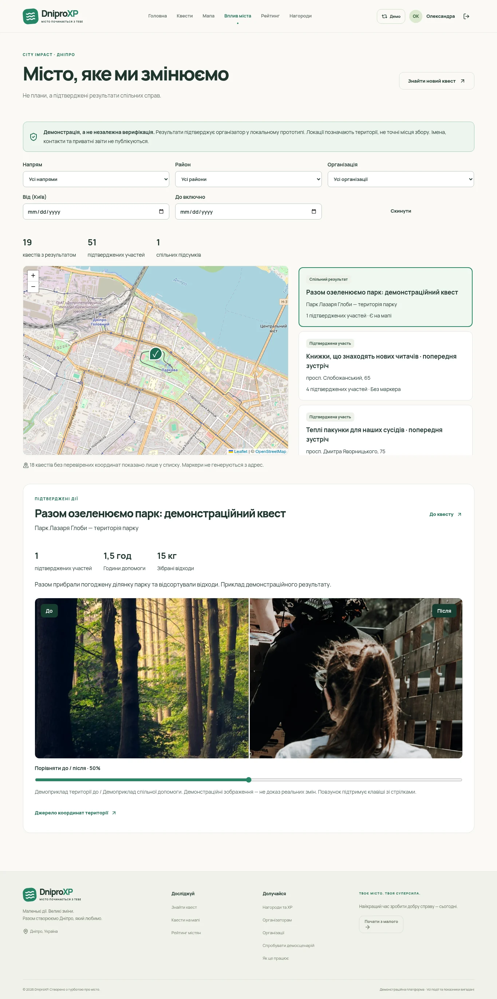

Mobile:

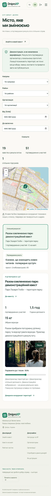

## Особистий чек та історія

Desktop:

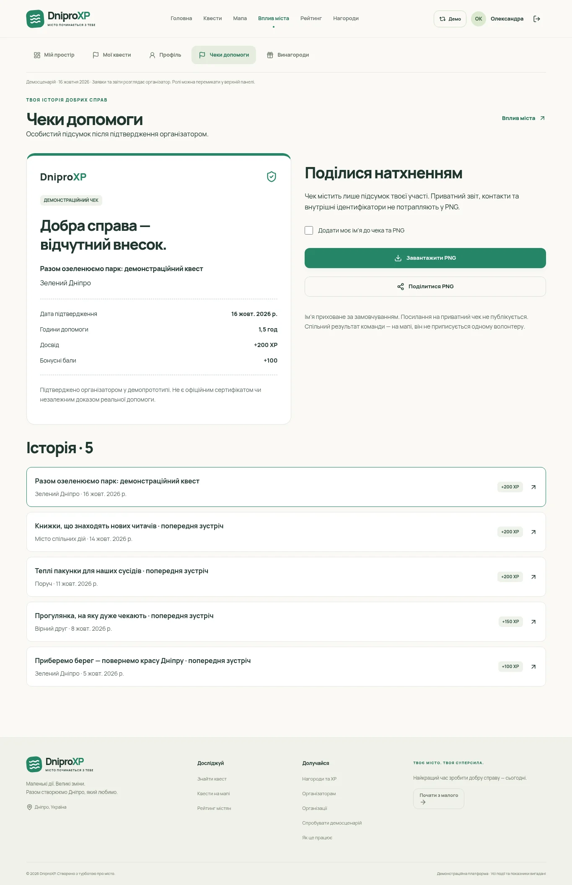

Mobile:

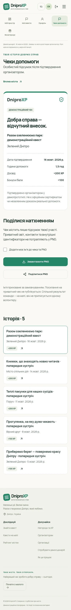

## Показники на головній

Desktop:

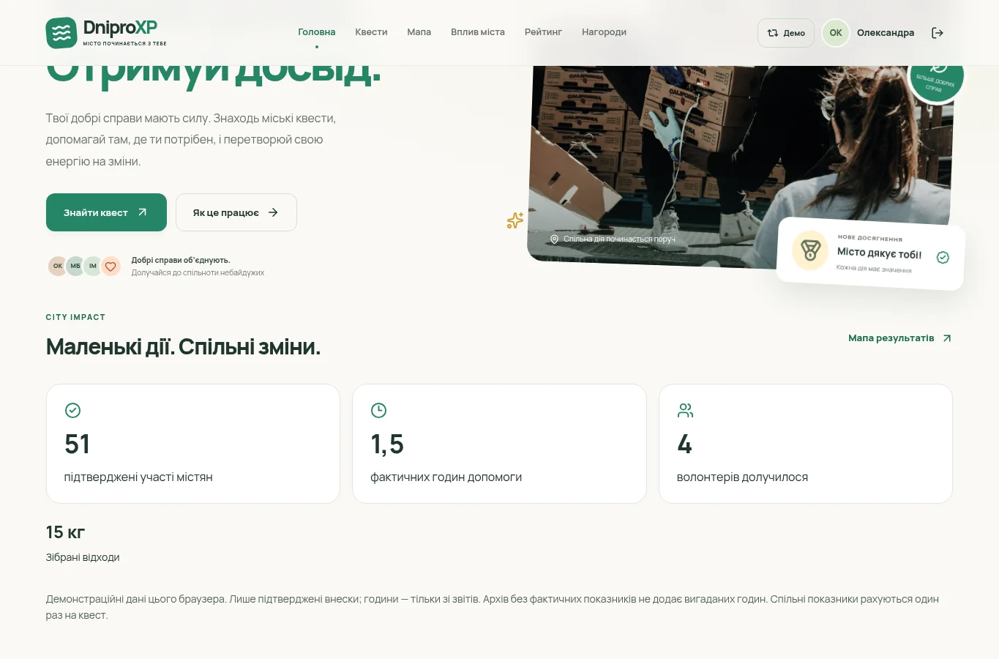

Mobile:

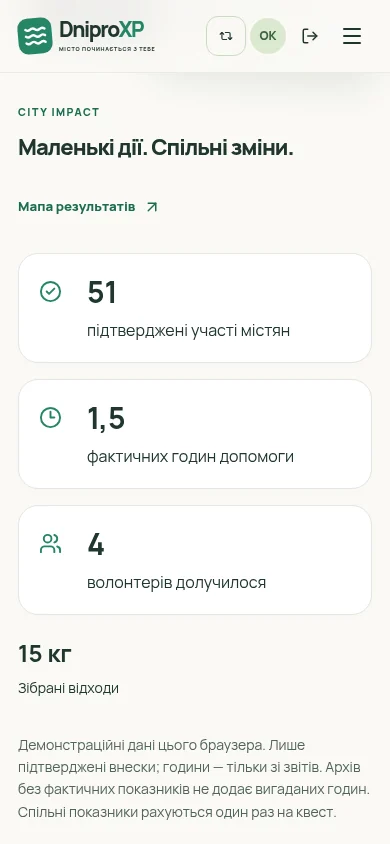

## Показники в кабінеті

Desktop:

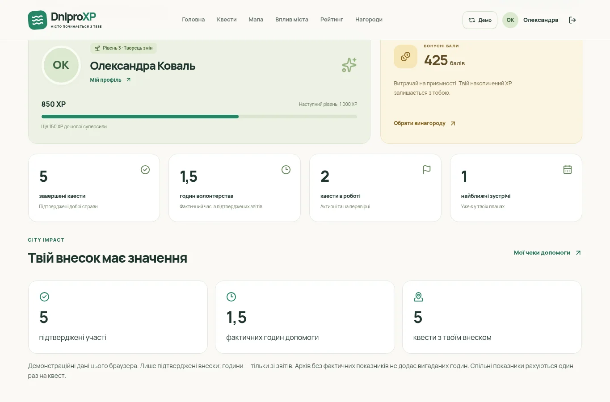

Mobile:

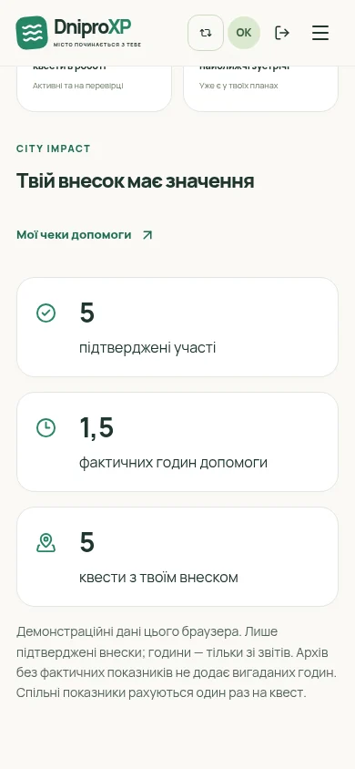

## Спільний підсумок організатора

Desktop:

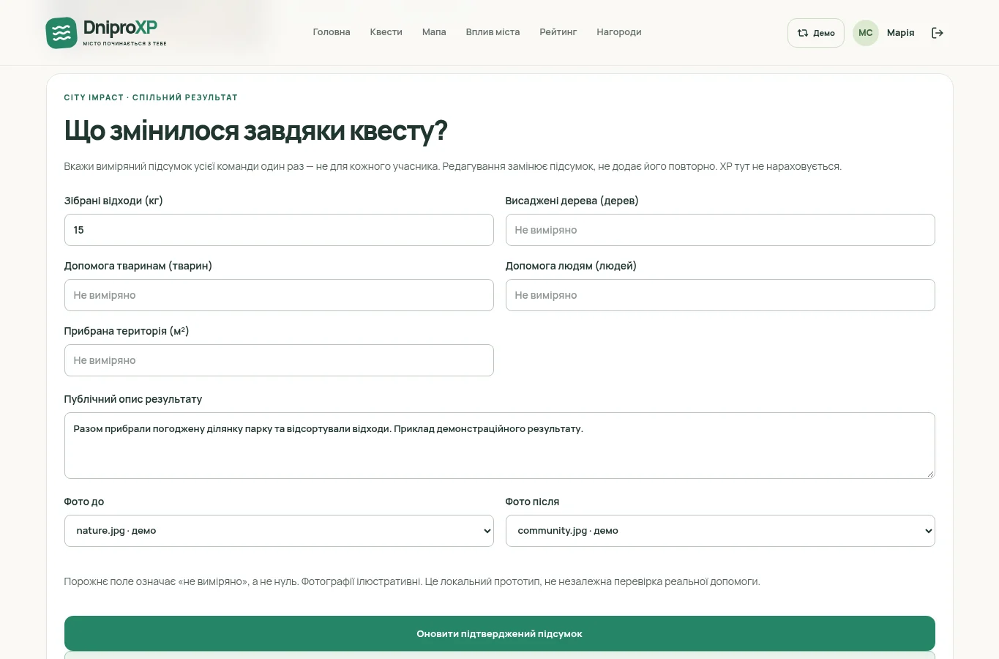

Mobile:

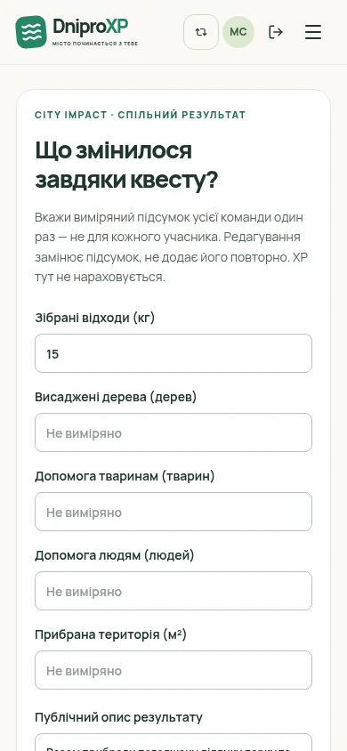

## Додаткові стани

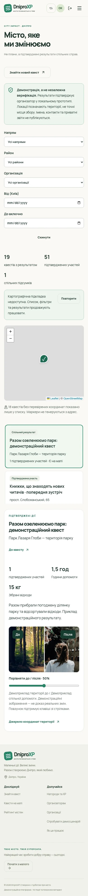

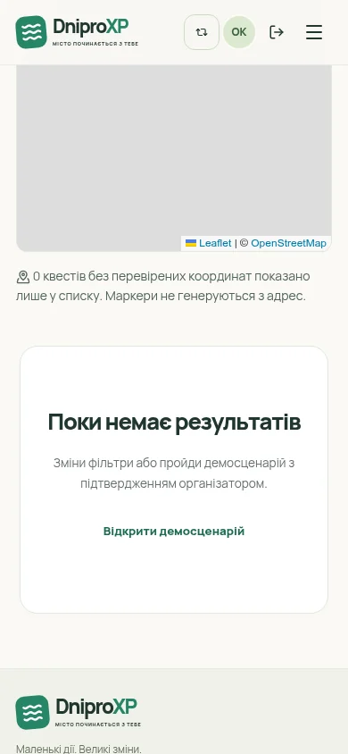

## Експортований PNG

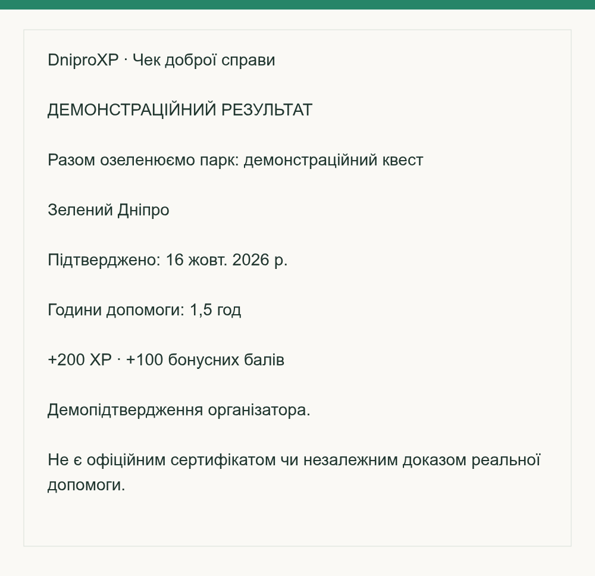
