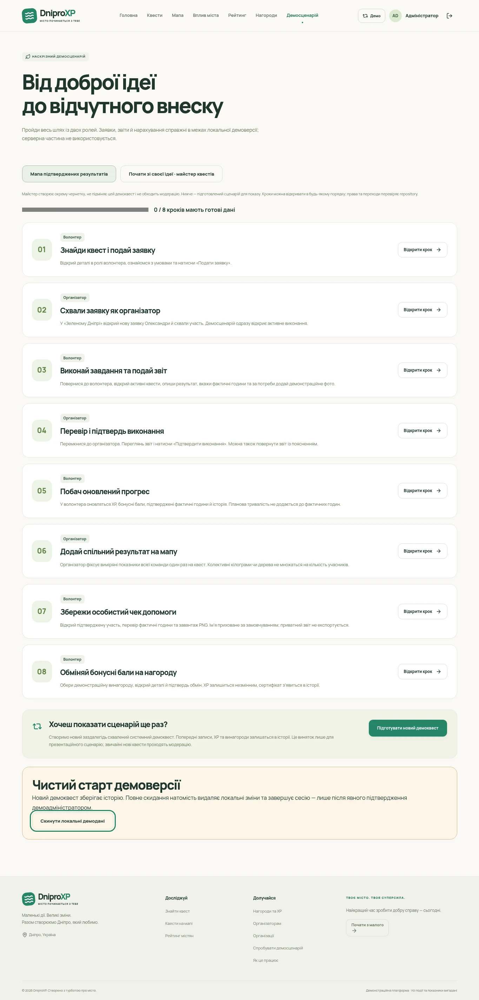
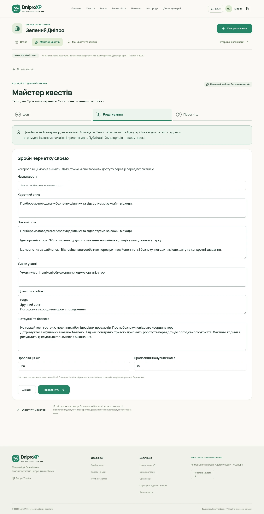
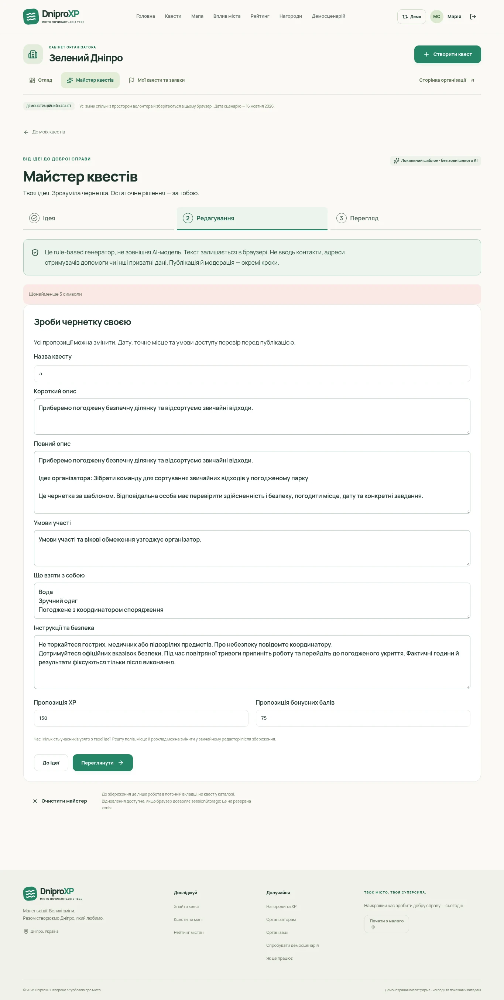
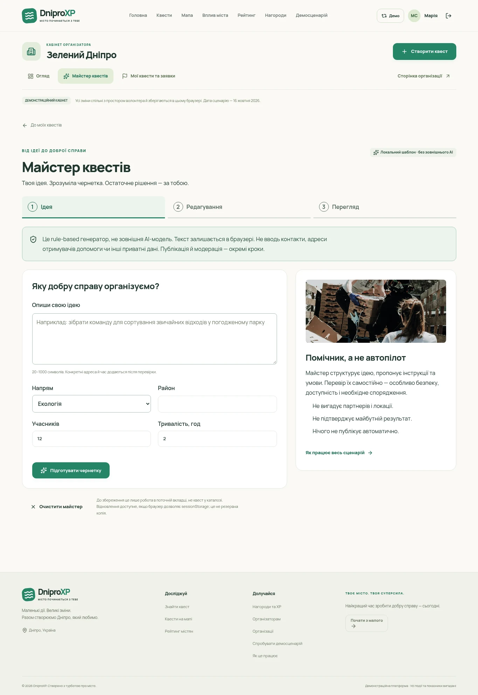
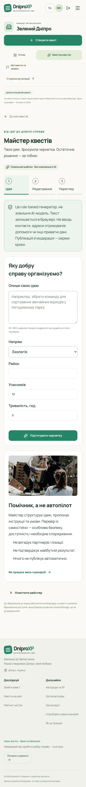
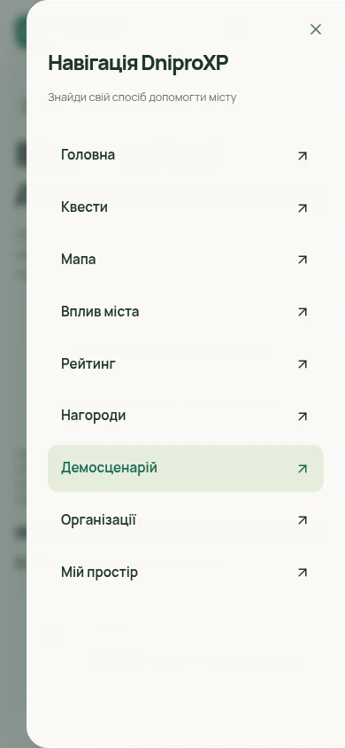
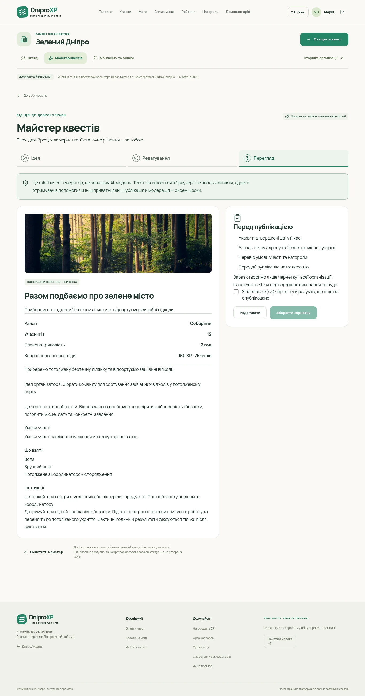
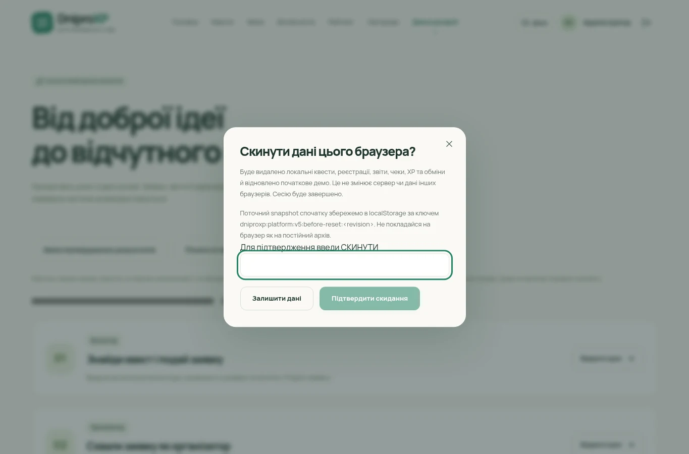

# EPIC 04 · Product Integration screenshots

Actual local Chromium renders of the implemented frontend, using the existing Manrope / Urban Friendly design. Desktop viewport 1365×900; mobile 390×844. Full-page screenshots retain the original width; dialogs/menu are viewport captures. Local demo data only. WebP conversion without cropping or resizing.

## Demo Desktop

## Demo Mobile

## Edit Desktop

## Edit Mobile

## Error Desktop

## Error Mobile

## Idea Desktop

## Idea Mobile

## Menu Mobile

## Preview Desktop

## Preview Mobile

## Reset Desktop

## Reset Mobile

